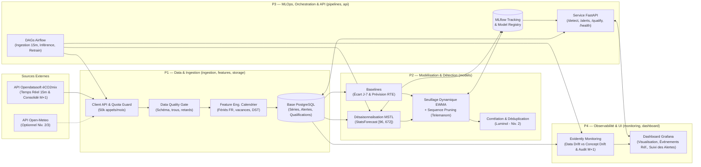

# Détection d'Anomalies sur le Réseau Électrique Français (MLOps — éCO2mix)

Service MLOps automatisé de bout en bout pour la surveillance du réseau électrique français à partir des données ouvertes **éCO2mix** publiées par **RTE** (via l'API Opendatasoft).

Le projet met l'accent sur **la chaîne de production MLOps** (contrôles de qualité des données, désaisonnalisation explicite, seuillage dynamique non paramétrique, versionnement MLflow, API FastAPI, monitoring de dérive Evidently et boucle de qualification humaine) plutôt que sur la complexité brute d'un modèle isolé.

---

## Documents de Référence du Projet

- **[CADRAGE.md](CADRAGE.md)** : Charte de kickoff (énoncé du problème, métriques clés, budget d'alertes, attribution des rôles P1–P4) et formulaire de décision de la stack technique.
- **[docs/anomalies-reseau-electrique.md](docs/anomalies-reseau-electrique.md)** : Cahier des charges détaillé du projet (Niveaux 1, 2 et 3) et sources de données.
- **[docs/revue-litterature.md](docs/revue-litterature.md)** : Revue de littérature complète synthétisant les 6 références bibliographiques (Hyndman *FPP3*, Nixtla `StatsForecast`, Meta `Prophet`, LinkedIn `Luminol`, Hundman et al. *NASA Telemanom*, `Evidently AI`).
- **[docs/donnees-eco2mix-national.md](docs/donnees-eco2mix-national.md)** : Backfill de l'historique national (export Opendatasoft → Parquet partitionné par année) et constats sur le pas de temps, les changements d'heure et les valeurs manquantes.
- **[CONTRIBUTING.md](CONTRIBUTING.md)** : Guide de contribution, conventions Git/CI, organisation par pôles (P1 à P4) et workflow de développement avec `uv`, `ruff` et `pytest`.

---

## Vue d'Ensemble de l'Architecture

### 1. Schéma des Flux & Composants MLOps



### 2. Stack Technique

| Brique MLOps | Outil retenu | Rôle dans l'architecture |
| :--- | :--- | :--- |
| **Orchestration** | **Apache Airflow** | Planification par DAGs des flux d'ingestion (15 min / 1 h), de détection et de réentraînement. |
| **Stockage & Requêtage** | **PostgreSQL** | Historisation idempotente (upsert) des séries temporelles, des alertes et des qualifications ; accès concurrent sûr pour l'API, les workers Airflow et le dashboard. |
| **Désaisonnalisation & Modèles** | **StatsForecast (Nixtla) + NumPy/SciPy** | Décomposition multi-saisonnière robuste (`MSTL`) et seuillage dynamique non paramétrique avec élagage (*Telemanom*). |
| **Tracking & Registre** | **MLflow** | Suivi des expériences, versionnement des modèles et des hyperparamètres de seuillage, promotion en production. |
| **API de Service** | **FastAPI** | Exposition REST des prédictions, de la liste des alertes et de la boucle de qualification humaine. |
| **Dashboard & Qualification** | **Grafana** | Visualisation temps réel branchée sur PostgreSQL, inspection sur événements de référence et suivi des alertes (la qualification passe par `POST /alerts/{id}/qualify`). |
| **Observabilité & Drift** | **Evidently AI** | Contrôles de qualité des données, détection de dérive (Wasserstein / PSI) et audit différé Temps Réel vs Consolidé ($M+1$). |
| **Packaging, Qualité & CI** | **uv + Ruff + Pytest + Docker** | Gestion reproductible des dépendances (`pyproject.toml`), linting/formatage, tests automatisés et conteneurisation. |

---

## Arborescence du Dépôt

L'architecture du code source sous `src/anomalies_elec/` est découpée selon les **4 pôles de responsabilité (P1 à P4)** afin de permettre le développement parallèle sans conflits Git :

```text
jun25_alt2_mle_mlops_anomalies_elec/
├── .github/
│   └── workflows/
│       └── ci.yml                      # Pipeline CI : linting (ruff) + tests (pytest) + validation docker compose
├── configs/
│   ├── default.yaml                    # Configuration globale (API URLs, fenêtres MSTL, budget d'alertes)
│   └── reference_events.yaml           # Événements historiques de référence (vagues de froid, canicules, fériés, grèves)
├── dags/                               # [P3] DAGs Airflow (squelettes : ingestion, détection, entraînement)
├── data/                               # Données locales du backend Parquet (ignorées par Git)
│   ├── raw/
│   ├── processed/                      # Séries enrichies (calendrier FR, résidus désaisonnalisés)
│   └── alerts/                         # Historique des alertes et qualifications humaines
├── docker/
│   ├── Dockerfile.api                  # Image du service FastAPI
│   ├── Dockerfile.airflow              # Image Airflow 3 + virtualenv projet (/opt/anomalies-venv)
│   ├── Dockerfile.mlflow               # Serveur MLflow 3 + driver PostgreSQL
│   └── postgres/init/
│       ├── 00_databases.sql            # Bases techniques : mlflow, airflow
│       └── 01_schema.sql               # Contrat de données partagé : tables series, alerts, monitoring_metrics
├── docs/
│   ├── anomalies-reseau-electrique.md  # Sujet et spécifications du projet
│   └── revue-litterature.md            # Revue de littérature détaillée
├── grafana/                            # [P4] Grafana provisionné as-code
│   ├── provisioning/                   # Source de données PostgreSQL + chargement des dashboards
│   └── dashboards/overview.json        # Dashboard de départ (séries, alertes)
├── src/
│   └── anomalies_elec/
│       ├── __init__.py
│       ├── config.py                   # Chargement typé (Pydantic) de la configuration
│       ├── ingestion/                  # [P1] Collecte & Contrôles Qualité
│       │   ├── eco2mix_client.py       # Client HTTP Opendatasoft v2.1 & gestion du quota (50k/mois)
│       │   └── quality.py              # Validation du schéma, trous de publication, valeurs figées
│       ├── storage/                    # [P1] Persistance idempotente
│       │   ├── base.py                 # Interface commune `Store` + `get_store()` (choix du backend)
│       │   ├── parquet_store.py        # Backend Parquet/DuckDB (dev local & tests, backend par défaut)
│       │   └── postgres_store.py       # Backend PostgreSQL (squelette, à implémenter par P1)
│       ├── features/                   # [P1/P2] Calendrier & Prétraitement
│       │   └── calendar_fr.py          # Jours fériés FR, ponts, vacances scolaires, changements d'heure (DST)
│       ├── models/                     # [P2] Baselines, Désaisonnalisation & Seuillage
│       │   ├── baselines.py            # Baseline J-7 (même heure) & Baseline Prévision RTE (J-1 / J)
│       │   ├── deseasonalize.py        # Désaisonnalisation multi-saisonnière MSTL (StatsForecast)
│       │   ├── thresholding.py         # Lissage EWMA + seuillage non paramétrique + pruning (Hundman et al.)
│       │   └── correlator.py           # [Niveau 2] Corrélation croisée avec décalage & déduplication inter-régions
│       ├── pipelines/                  # [P3] Logique des pipelines, appelée par les DAGs Airflow
│       │   ├── ingest_flow.py          # Ingestion incrémentale + Data Quality Gate
│       │   ├── train_flow.py           # Entraînement, évaluation et enregistrement MLflow
│       │   └── detect_flow.py          # Inférence continue et génération d'alertes
│       ├── api/                        # [P3] Exposition REST
│       │   ├── main.py                 # Application FastAPI (/health, /detect, /alerts, /alerts/{id}/qualify)
│       │   └── schemas.py              # Schémas Pydantic de validation d'entrées/sorties
│       └── monitoring/                 # [P4] Observabilité & Dérive (métriques écrites dans monitoring_metrics)
│           ├── drift.py                # Data Drift vs Concept Drift (Evidently / Wasserstein)
│           └── consolidated_audit.py   # [Niveau 3] Confrontation Temps Réel (TR) vs Consolidé (M+1)
├── tests/                              # Suite de tests unitaires et d'intégration (pytest)
├── CADRAGE.md                          # Charte d'équipe (Tâches 1 & 2)
├── CONTRIBUTING.md                     # Guide de contribution et conventions de développement
├── README.md                           # Ce document
├── docker-compose.yml                  # Orchestration multi-conteneurs locale
└── pyproject.toml                      # Configuration du package, dépendances uv, ruff et pytest
```

---

## Progression Évolutive (Niveaux 1 à 3)

L'architecture est conçue dès le départ autour du format tabulaire multi-séries standard (`unique_id`, `ds`, `y`) afin de passer du Niveau 1 au Niveau 3 sans réécriture structurelle :

1. **Niveau 1 — Une série nationale, une chaîne complète :**
   - `unique_id = "FR"`, pas de temps de 15 minutes (`freq = "15min"`).
   - Contrôle qualité en amont (`ingestion/quality.py`) pour isoler les pannes de télémesure.
   - Enrichissement calendaire (`features/calendar_fr.py`) et comparaison systématique avec les **2 baselines** (`models/baselines.py` : écart à $J-7$ même heure et écart à la prévision RTE).
   - Désaisonnalisation explicite par **MSTL** (`season_length=[96, 672]`) suivie du **seuillage dynamique non paramétrique avec élagage** (`models/thresholding.py`) et évaluation sur le catalogue d'événements de référence (`configs/reference_events.yaml`).
2. **Niveau 2 — Passage à l'échelle régional & flotte de modèles :**
   - Extension aux 12 régions métropolitaines (`unique_id` par code région INSEE/RTE) au pas horaire (`season_length=[24, 168]`).
   - Exploitation multivariée (consommation, filières de production nucléaire/éolien/solaire/hydraulique, échanges aux frontières) et déduplication d'alertes entre régions limitrophes via `models/correlator.py`.
3. **Niveau 3 — Boucle de rétroaction & observabilité avancée :**
   - Qualification humaine des alertes via `POST /alerts/{id}/qualify` et le dashboard Grafana pour ajuster le seuil d'élagage $p$ et suivre la précision opérationnelle dans le temps.
   - Distinction entre **régime saisonnier atypique** (*Data Drift* sur la consommation brute mais résidus stables vis-à-vis de la météo/prévision) et **dégradation du modèle** (*Concept Drift* sur les résidus) avec `monitoring/drift.py`.
   - Confrontation automatisée à $M+1$ entre les alertes émises sur le flux Temps Réel (`eco2mix-*-tr`) et les données définitives (`eco2mix-*-cons-def`) via `monitoring/consolidated_audit.py`.

---

## Démarrage Rapide

### 1. Prérequis
- [`uv`](https://docs.astral.sh/uv/) (gestionnaire de dépendances et d'environnements virtuels) — il installe lui-même **Python 3.11**, version fixée par `.python-version` (identique aux images Docker et à la CI)
- Docker Desktop / Docker Compose (pour l'environnement complet)

### 2. Installation locale avec `uv`

```bash
# Installer toutes les dépendances : base + outils de dev (groupe installé par défaut) + extra MLOps
uv sync --all-extras

# Activer les hooks Git (ruff, fins de ligne, YAML...) — une seule fois par clone
uv run pre-commit install

# Vérifier la qualité du code (linting & formatage)
uv run ruff check src/ tests/ dags/

# Lancer la suite de tests
uv run pytest -v
```

### 3. Lancer l'API seule en local (backend Parquet, sans Docker)

```bash
# API FastAPI (http://localhost:8000/docs) — stockage dans ./data
uv run uvicorn anomalies_elec.api.main:app --reload --port 8000
```

### 4. Lancement complet via Docker Compose

```bash
cp .env.example .env          # optionnel : des valeurs par défaut de dev sont prévues
docker compose up --build -d
docker compose ps             # airflow-init doit être "exited (0)", les autres "running"/"healthy"
```

| Service | URL | Identifiants (dev) |
| :--- | :--- | :--- |
| API FastAPI (Swagger UI) | `http://localhost:8000/docs` | — |
| Airflow 3 | `http://localhost:8080` | aucun (SimpleAuthManager, tout le monde admin en local) |
| MLflow | `http://localhost:5000` | — |
| Grafana | `http://localhost:3000` | `admin` / `admin` |
| PostgreSQL | `localhost:5432` | `anomalies` / `anomalies` (bases `anomalies`, `mlflow`, `airflow`) |

> [!NOTE]
> - Le stockage reste sur le backend **Parquet** (`STORAGE_BACKEND=parquet`) tant que `PostgresStore` n'est pas implémenté par P1 ; les tables PostgreSQL sont déjà créées et visibles dans Grafana.
> - Les scripts `docker/postgres/init/*.sql` ne s'exécutent qu'à la création du volume : après une modification du schéma, `docker compose down -v` (⚠️ efface les données locales).
> - Les DAGs Airflow sont en pause à leur création ; les squelettes ne font qu'une vérification d'environnement.
> - **Après une modification de `src/`, `configs/`, `pyproject.toml` ou `uv.lock`, reconstruire les images :** `docker compose up --build -d`. Le code est copié dans les images API et Airflow au build : sans `--build`, les conteneurs exécutent l'ancienne version. Seul `dags/` est monté en direct (modifications prises en compte sans rebuild).
> - **Qualification humaine :** Grafana est en lecture seule ; les alertes se qualifient via `POST /alerts/{alert_id}/qualify` (Swagger UI).
