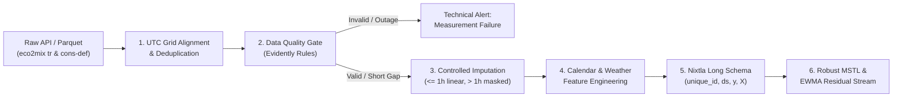

# Data Exploration (EDA) & Preprocessing Methodology — Power Grid Anomaly Detection (MLOps)

**Date:** 2026-11-27  
**Proposed by:** Sathapana  
**References:** [docs/revue-litterature.md](revue-litterature.md) | [docs/anomalies-reseau-electrique.md](anomalies-reseau-electrique.md)

---

## 1. Strategic Pillars from the Literature Review

This methodology translates the six foundational references analyzed in [docs/revue-litterature.md](revue-litterature.md) into an actionable, production-grade **Exploratory Data Analysis (EDA)** and **Preprocessing** pipeline across Levels 1, 2, and 3 of the RTE éCO2mix anomaly detection service.

| Strategic Pillar | Literature Source | Operational Rule for EDA & Preprocessing |
| :--- | :--- | :--- |
| **1. Data Quality Before Anomaly/Drift** | **Evidently AI** (*Data Drift in ML*) | Never feed corrupted telemetry into a detector. Filter API dropouts, frozen sensors, and scale errors via explicit **Data Quality gates** before running deseasonalization or drift tests. |
| **2. Calendar & Variance Stabilization First** | **Hyndman & Athanasopoulos (*FPP3*, Chap. 3)** & **Meta (`Prophet`)** | Remove known deterministic variations (French holidays, bridge days / *ponts*, school holidays, DST transitions) and test whether variance scales with load (Box-Cox $\lambda$) before decomposing. |
| **3. Detection on Robust Multi-Seasonal Residuals ($R_t$)** | **Hyndman (*FPP3*)** & **Nixtla (`StatsForecast`)** | Do not detect anomalies on raw load $y_t$. Extract the remainder $R_t$ via **robust MSTL** (`season_length=[96, 672]` at 15-min steps) so outliers do not distort trend $T_t$ or seasonal components $S_t$. |
| **4. Long-Format Schema for Fleet Scalability** | **Nixtla (`StatsForecast`)** | Standardize all series into `(unique_id, ds, y, [exogenous])` from Level 1 (`unique_id="FR_conso"`) so scaling to Level 2 (12 metropolitan regions + production sectors) requires zero pipeline refactoring. |
| **5. Error Smoothing & First-Order Derivatives** | **Hundman et al. (*NASA Telemanom*, KDD 2018)** & **LinkedIn (`Luminol`)** | Preprocess residual streams ($R_t$, RTE forecast errors, $J-7$ errors, and first differences $\Delta y_t$) with **EWMA smoothing** to suppress 15-minute high-frequency noise before non-parametric thresholding. |

---

## 2. Phase 1: Exploratory Data Analysis (EDA) Methodology

The goal of EDA is to calibrate preprocessing rules, validate physical and statistical assumptions, and construct the **Reference Events Dataset** required for Level 1 evaluation.

### 2.1. Cadence, Completeness & Data Quality Audit (*Evidently AI*)
1. **Sampling Granularity Audit (`cons-def` vs `tr`):**
   * Historical éCO2mix datasets contain structural frequency transitions across years (e.g., 30-minute actuals padded with empty 15-minute rows in older archives vs native 15-minute national and 1-hour regional cadences). Quantify non-null density per column by year.
2. **Missingness & Staleness Profiling:**
   * Measure the distribution of consecutive missing timestamps (isolated single-point drop vs multi-hour Opendatasoft API outage).
   * Detect **frozen telemetry** ($\Delta y_t = y_t - y_{t-1} = 0$ over $k \ge 3$ consecutive 15-min steps) and negative or out-of-bound values.
3. **Physical Coherence Checks (Level 2 readiness):**
   * Verify the physical grid accounting identity across national and regional tables:
     $$\text{Consommation} \approx \sum \text{Production}_{\text{filières}} + \text{Solde Échanges} + \text{Pompage}$$
4. **Real-Time (`tr`) vs Consolidated (`cons-def`) Drift Audit (Level 3 readiness):**
   * Compare overlapping periods between `eco2mix-national-tr` and `eco2mix-national-cons-def` ($M+1$) to characterize measurement revision distributions and baseline feedback delay.

### 2.2. Distributional & Variance Analysis (*Hyndman FPP3*)
1. **Additive vs Multiplicative Seasonality Test:**
   * Plot rolling seasonal amplitude (daily peak-to-trough range) against rolling mean consumption $T_t$ (winter high load vs summer low load).
   * Estimate the optimal **Box-Cox parameter $\lambda$** (Guerrero's method or profile log-likelihood) to determine whether variance stabilization is required prior to `MSTL`.
2. **Thermosensitivity Profiling (Exogenous Open-Meteo):**
   * Cross-plot consumption against population-weighted national and regional temperature.
   * Identify the piecewise linear threshold (~$14^\circ\text{C}\text{--}15^\circ\text{C}$) below which electric heating drives steep load increases (~$2\,400\text{ MW}/^\circ\text{C}$ nationally) and the summer cooling threshold (~$22^\circ\text{C}$).

### 2.3. Multi-Seasonality & Calendar Profiling (*FPP3*, *StatsForecast*, *Prophet*)
1. **Spectral & Autocorrelation Analysis (ACF / PACF / Periodogram):**
   * Confirm dominant periodicities at 15-minute resolution:
     * **Intra-day cycle:** $m_1 = 96$ (morning ramp-up, midday plateau, evening peak, night trough).
     * **Intra-week cycle:** $m_2 = 96 \times 7 = 672$ (weekday vs Saturday vs Sunday profile).
     * **Annual cycle:** $m_3 \approx 35\,064$ (captured via annual Fourier terms, rolling LOESS trend, or degree-days).
2. **Calendar Anomaly Profiling:**
   * Compare load profiles on **French public holidays**, **bridge days (*ponts* — e.g., May holidays, Ascension Friday)**, **August vacation weeks**, and **DST switch days** (March/October) against standard weekdays.

### 2.4. Baseline Error & Reference Event Exploration (*Telemanom*, *Luminol*)
1. **Build the Reference Events Catalog (Level 1 requirement):**
   * Curate labeled time windows covering:
     * *Cold waves / Heatwaves* (sustained regime shifts, e.g., Feb 2012, Jan 2017, Feb 2018, summer heatwaves).
     * *Calendar anomalies* (August 15th Sunday, Christmas/New Year, May bridge days).
     * *Social movements / Structural shocks* (COVID-19 lockdown March 2020, energy sobriety winter 2022–2023, grid/nuclear strikes).
     * *Data quality faults* (real or simulated API freezes/dropouts).
2. **Baseline Residual Distribution Analysis:**
   * Compute and inspect Q-Q plots and tail heaviness (kurtosis) of:
     * Weekly seasonal naive residual: $e_t^{J-7} = y_t - y_{t-672}$
     * RTE Day-Ahead & Intra-Day forecast residuals: $e_t^{\text{RTE-}J-1} = y_t - \hat{y}_t^{J-1}$ and $e_t^{\text{RTE-}J} = y_t - \hat{y}_t^{J}$
     * `MSTL` in-sample residual: $R_t = y_t - \hat{T}_t - \hat{S}_{96,t} - \hat{S}_{672,t}$
   * Confirm heavy tails and departures from Gaussianity—empirically justifying **Hundman et al.'s non-parametric dynamic thresholding ($\epsilon^*$)** over static $3\sigma$ rules.
3. **Lagged Cross-Correlation Exploration (*Luminol*):**
   * Compute lagged cross-correlations (`scipy.signal.correlate` within $\pm 2\text{ hours}$) between consumption residuals, generation drops (nuclear, wind, solar, hydro), and neighboring regional exchange balances.

---

## 3. Phase 2: Preprocessing & Feature Engineering Methodology

To satisfy the MLOps requirement (*"a simple, versioned, monitored, deployed, and automatically retrainable pipeline"*), preprocessing is structured as a deterministic, idempotent DAG:

### Step 1: Temporal Standardization & Idempotent Partitioning
* **UTC Normalization:** Convert all timestamps to **strict UTC** (`ds`) immediately upon ingestion. Local French time (`Europe/Paris`) introduces a missing hour in March (spring forward) and a duplicate hour in October (fall back), which breaks fixed-lag seasonal indices ($t - 96$, $t - 672$).
* **Explicit Local Time Features:** Preserve `hour_local` and `is_dst_transition` as explicit columns before converting the index to UTC.
* **Grid Reindexing & Deduplication:** Deduplicate on `(unique_id, ds)` (retaining the latest publication record for idempotence) and reindex onto a complete 15-minute UTC grid (`freq="15min"`).

### Step 2: Automated Data Quality Gate (*Evidently AI*)
Before any imputation or modeling, evaluate each incoming batch against hard Data Quality rules:
1. **Schema & Freshness Check:** Verify required columns exist and ingestion lag $(t_{\text{now}} - \max(\text{ds}))$ is within the publication SLA.
2. **Physical Bound Check:** Enforce domain constraints (e.g., national load $\in [15\,000, 120\,000]\text{ MW}$, regional load $> 0$).
3. **Frozen Sensor Check:** Flag series where $\text{std}(y_{t-k:t}) = 0$ over $k \ge 4$ steps.
4. **Routing Rule:** If a data quality check fails, **emit a Data Quality / Measurement Chain Alert immediately** and exclude the corrupted window from operational anomaly detection and automated model retraining.

### Step 3: Gap Handling Strategy
* **Sub-hourly historical alignment:** For historical transitions where actuals were recorded every 30 minutes, downsample uniformly or interpolate intermediate 15-minute points *only* where surrounding 30-minute bounds are valid.
* **Short operational gaps ($\le 4$ steps / $1\text{ hour}$):** Apply time-weighted linear interpolation (`limit=4`) and set a boolean flag `is_imputed = True`.
* **Long gaps ($> 1\text{ hour}$):** **Do not interpolate** (interpolating across a multi-hour outage creates an artificial straight line that corrupts seasonal profiles and triggers false residual anomalies). Leave as `NaN` / masked window and log as an ingestion gap.

### Step 4: Calendar & Exogenous Feature Engineering (*Hyndman FPP3* & *Prophet* principles without `CmdStan`)
Because `Prophet` is in maintenance mode and requires heavy `CmdStan` compilation, calendar and exogenous effects are extracted via a lightweight feature pipeline:
* **French Holidays & Bridges (`holidays` + `vacances-scolaires-france`):**
  * `is_public_holiday`: Binary indicator for French statutory holidays.
  * `is_bridge_day` (*pont*): Monday before a Tuesday holiday, or Friday after a Thursday holiday (e.g., Ascension).
  * `holiday_window`: Distance in days $\in [-2, +2]$ to the nearest major holiday (Christmas, New Year, Easter, May holidays).
  * `school_holiday_weight`: Fraction of metropolitan zones (A, B, C) on school vacation $\in \{0, 1/3, 2/3, 1\}$.
* **Cyclical & Regime Features:**
  * `day_of_week_effective`: Recode public holidays and bridge days to behave like Sunday (`6`) or Saturday (`5`) for the $J-7$ baseline lookup so a weekday holiday is compared to a rest day rather than a standard working day.
* **Weather Features (Open-Meteo integration for Level 2/3):**
  * $\text{HDD}_t = \max(0, 15^\circ\text{C} - T_t)$ (Heating Degree Days) and $\text{CDD}_t = \max(0, T_t - 22^\circ\text{C})$ (Cooling Degree Days).
  * $T_{\text{smooth}, t} = \text{EWMA}_{24\text{h}}(T_t)$ to capture building thermal inertia.

### Step 5: Canonical Formatting for `StatsForecast` (*Nixtla*)
Store preprocessed series in Nixtla's canonical long format in partitioned Parquet files (`data/processed/level={national|regional}/year=YYYY/`):
* `unique_id`: `"FR_conso"` (Level 1), or `"{code_insee_region}_{metric}"` (Level 2, e.g., `"11_conso"`, `"84_eolien"`).
* `ds`: UTC timestamp (`datetime64[ns, UTC]`).
* `y`: Target value (Box-Cox transformed if EDA confirms heteroscedasticity, or calendar-adjusted).
* Baseline & metadata columns: `y_hat_rte_j1`, `y_hat_rte_j`, `y_lag_effective_7d`, `is_imputed`, `dq_valid`.

### Step 6: Residual Extraction & EWMA Pre-Smoothing (*StatsForecast*, *Telemanom*, *Luminol*)
Produce the final preprocessed feature matrix consumed by the anomaly detection and thresholding layer:
1. **Multi-Seasonal Decomposition (`StatsForecast.MSTL`):**
   * Fit `MSTL(season_length=[96, 672])` (with robust LOESS trend and seasonal extraction) to decompose $y_t = \hat{T}_t + \hat{S}_{96,t} + \hat{S}_{672,t} + R_t$ and generate in-sample prediction intervals (`level=[99]`).
2. **Parallel Error Streams:**
   * $e_t^{(1)} = |y_t - y_{t,\text{effective } J-7}|$ (Calendar-adjusted weekly baseline error)
   * $e_t^{(2)} = |y_t - \hat{y}_t^{\text{RTE}}|$ (RTE forecast discrepancy)
   * $e_t^{(3)} = |R_t|$ (MSTL deseasonalized residual magnitude)
   * $e_t^{(4)} = |\Delta R_t| = |R_t - R_{t-1}|$ (*Luminol*-inspired derivative score for sudden drops or ramps)
3. **EWMA Error Smoothing (*Hundman et al. Telemanom*):**
   * Smooth each error stream $e_t^{(k)}$ via an Exponentially Weighted Moving Average:
     $$\mathbf{e}_{s,t}^{(k)} = \alpha e_t^{(k)} + (1-\alpha)\mathbf{e}_{s,t-1}^{(k)}$$
     (with span tuned on the Reference Events Catalog, typically 2–4 steps / 30–60 min) so transient 15-minute jitter is dampened while genuine anomalies are passed to the dynamic thresholding ($\epsilon^*$) and sequence pruning stage.
