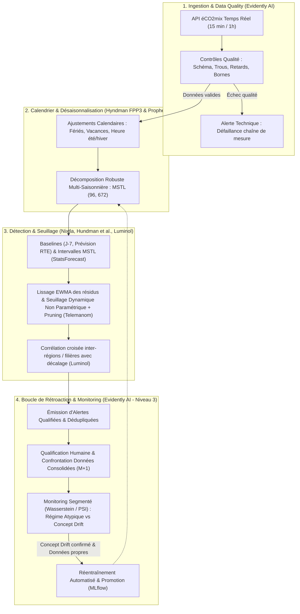

# Revue de littérature — Détection d'anomalies sur le réseau électrique (MLOps)

Ce document synthétise les six références de la section **Bibliographie** de la spécification du projet ([anomalies-reseau-electrique.md](file:///home/antigravity/Sathapana/jun25_alt2_mle_mlops_anomalies_elec/docs/anomalies-reseau-electrique.md)). Il met en perspective leurs concepts théoriques, leurs choix algorithmiques et leur application concrète aux trois niveaux du pipeline MLOps de surveillance du réseau électrique français (données éCO2mix de RTE).

---

## 1. Synthèse comparative des références

| Référence | Domaine principal | Apport clé pour le projet | Niveau(x) cible(s) | Statut / Maturité technique |
| :--- | :--- | :--- | :--- | :--- |
| **Hyndman & Athanasopoulos** (*FPP3*, Chap. 3) | Décomposition de séries temporelles | Désaisonnalisation explicite (STL / MSTL), transformations (Box-Cox) et effets calendaires avant toute détection | Niveau 1 & 2 | Fondement théorique de référence |
| **Nixtla (`StatsForecast`)** | Prévision probabiliste & détection d'anomalies par intervalles | Modèle `MSTL` multi-saisonnalité ultra-rapide, intervalles de prédiction (`level=99`), exécution distribuée (Ray/Dask/Spark) | Niveau 1 & 2 | Production-ready, haute performance |
| **Meta (`Prophet`)** | Modélisation additive multi-saisonnière & jours fériés | Gestion native des jours fériés (`holidays`), ruptures de tendance et régresseurs exogènes (ex. météo) | Niveau 1 | En mode maintenance (v1.4/1.5) — utile en baseline ou référence |
| **LinkedIn (`Luminol`)** | Détection légère sans seuil fixe & corrélation | Score d'anomalie par bitmap / EMA et corrélation temporelle avec décalage (`cross_correlator`) entre séries | Niveau 1 & 2 | Librairie historique (Python 2/3 ancien) — concepts à réimplémenter |
| **Hundman et al. (KDD 2018)** (*NASA Telemanom*) | Seuillage dynamique non paramétrique & réduction des faux positifs | Lissage des erreurs de prédiction (EWMA), seuil dynamique non paramétrique ($\epsilon$) et élagage (*pruning*) des séquences | Niveau 2 & 3 | État de l'art industriel pour l'alerting sur télémétrie |
| **Evidently AI** (*Data Drift in ML*) | Observabilité MLOps & détection de dérive | Distinction entre anomalie ponctuelle, problème de qualité de donnée, *data drift* et *concept drift* ; gestion du *feedback delay* | Niveau 3 | Standard MLOps open-source en Python |

---

## 2. Analyse détaillée par référence

### 2.1. Décomposition saisonnière : *Forecasting: Principles and Practice (3rd ed.)* — Hyndman & Athanasopoulos
* **Source :** [otexts.com/fpp3 (Chapitre 3 : Time series decomposition)](https://otexts.com/fpp3/decomposition.html)

#### Concepts clés
* **Composantes d'une série temporelle :** Une série $y_t$ est décomposée en une tendance-cycle $T_t$, une (ou plusieurs) composante(s) saisonnière(s) $S_t$, et un résidu (*remainder*) $R_t$ :
  * *Décomposition additive :* $y_t = T_t + S_t + R_t$ (pertinente lorsque l'amplitude saisonnière ne dépend pas du niveau moyen).
  * *Décomposition multiplicative :* $y_t = T_t \times S_t \times R_t$ (pertinente lorsque la variance saisonnière croît avec le niveau ; équivalente à une décomposition additive après transformation logarithmique ou Box-Cox).
* **Ajustements préalables :** Les auteurs insistent sur la nécessité d'éliminer les variations connues (effets calendaires, changements d'heure, jours ouvrés vs chômés) et de stabiliser la variance (transformation de Box-Cox avec paramètre $\lambda$) avant de modéliser.
* **Limites de la décomposition classique :** Basée sur des moyennes mobiles centrées ($2 \times m$-MA), elle ne fournit pas de résidus sur les bords de la série (les $m/2$ dernières observations manquent), suppose une saisonnalité figée d'une année sur l'autre, et est très sensible aux valeurs aberrantes.
* **Décomposition STL (*Seasonal and Trend decomposition using Loess*) et MSTL :**
  * Contrairement aux méthodes X-11 ou SEATS (limitées aux données mensuelles ou trimestrielles), **STL** gère n'importe quelle fréquence d'échantillonnage (horaire, quart d'heure) et son extension **MSTL** (Bandara, Hyndman & Bergmeir) décompose simultanément plusieurs périodes saisonnières.
  * L'option `robust = TRUE` pondère les observations par la méthode de bisquare lors des régressions locales LOESS : les anomalies ponctuelles n'écrasent ni la tendance $T_t$ ni la saisonnalité $S_t$, et se retrouvent intégralement isolées dans le résidu $R_t$.

#### Pertinence pour le projet éCO2mix
> [!IMPORTANT]
> Comme le souligne le cahier des charges, *« un dimanche d'août ressemble à une panne majeure vu par un détecteur non désaisonnalisé »*. La détection d'anomalies sur le réseau électrique doit impérativement opérer sur la **composante résiduelle $R_t$** issue d'une décomposition robuste multi-saisonnière (cycle journalier de 96 points au pas 15 min, cycle hebdomadaire de 672 points, cycle annuel), et non sur la consommation brute $y_t$.

---

### 2.2. Détection d'anomalies par prévision probabiliste : *StatsForecast (Nixtla)*
* **Source :** [Nixtla — Anomaly Detection Tutorial](https://nixtlaverse.nixtla.io/statsforecast/docs/tutorials/anomalydetection.html)

#### Concepts clés
* **Approche *In-Sample Prediction Intervals* :** Le tutoriel montre comment utiliser un modèle de décomposition et prévision probabiliste pour identifier les anomalies historiques et temps réel :
  1. Instancier un modèle **MSTL** avec plusieurs longueurs de cycles saisonniers (ex. `MSTL(season_length=[24, 24*7])` en pas horaire, ou `[96, 96*7]` en pas 15 minutes).
  2. Ajuster le modèle et produire les prévisions avec `sf.forecast(df=df, h=..., level=[99], fitted=True)`.
  3. Récupérer les valeurs ajustées et leurs intervalles de confiance sur l'historique via `sf.forecast_fitted_values()`.
  4. Toute observation $y_t$ tombant en dehors de l'intervalle de prédiction à $99\%$ (`y < MSTL-lo-99` ou `y > MSTL-hi-99`) est qualifiée d'anomalie.
* **Passage à l'échelle (MLOps) :** `StatsForecast` adopte un format tabulaire long standardisé (`unique_id`, `ds`, `y`) permettant d'entraîner une flotte de modèles en parallèle (`n_jobs=-1`) ou de manière distribuée (Dask, Ray, Spark) avec une empreinte mémoire minimale et une intégration native à MLflow.

#### Pertinence pour le projet éCO2mix
* **Niveau 1 :** `MSTL` dans `StatsForecast` constitue le candidat idéal pour le cœur du pipeline de Niveau 1. Il implémente directement la désaisonnalisation recommandée par Hyndman tout en fournissant nativement un intervalle de confiance probabiliste pour le seuillage.
* **Niveau 2 :** Le schéma `unique_id` permet de passer sans changement d'architecture de la série nationale (`unique_id = "FR"`) aux 12 régions métropolitaines (`unique_id = "IDF"`, `"ARA"`, etc.) ou aux différentes filières de production.

---

### 2.3. Saisonnalités multiples et effets calendaires : *Facebook / Meta Prophet*
* **Source :** [github.com/facebook/prophet](https://github.com/facebook/prophet) — Taylor & Letham (2018), *Forecasting at scale*.

#### Concepts clés
* **Modèle additif/multiplicatif décomposable :**
  $$y(t) = g(t) + s(t) + h(t) + \epsilon_t$$
  où $g(t)$ est une tendance linéaire ou logistique par morceaux avec détection automatique des points de rupture (*changepoints*), $s(t)$ modélise les saisonnalités multiples (journalière, hebdomadaire, annuelle) via des séries de Fourier, et $h(t)$ capture les effets des jours fériés et événements ponctuels.
* **Gestion native du calendrier et variables exogènes :** Intégration directe du package Python `holidays` (incluant les jours fériés français), possibilité de définir des fenêtres autour des fériés (`lower_window`, `upper_window` pour les ponts) et d'ajouter des régresseurs externes (`add_regressor`, ex. température Open-Meteo).
* **Robustesse :** Supporte nativement les trous de données (pas besoin d'interpoler avant l'entraînement) et produit des intervalles d'incertitude (`yhat_lower`, `yhat_upper`).

#### Pertinence et limites pour le projet éCO2mix
* **Avantage :** Résout élégamment l'exigence du Niveau 1 sur la *« gestion du calendrier (jours fériés, changements d'heure, vacances scolaires) »*, là où STL/MSTL pur ne gère pas nativement les jours fériés mobiles (Pâques, Ascension, ponts de mai).
* **Point de vigilance MLOps :** Le dépôt officiel indique que **Prophet est désormais en mode maintenance** (depuis la v1.4.0) et repose sur la compilation de binaires C++ `CmdStan` (nécessitant plusieurs Go de RAM au build). Dans une chaîne MLOps moderne, il est souvent préférable d'extraire des features calendaires explicites (jours fériés, ponts, vacances scolaires par zone) ou d'utiliser `StatsForecast` / `MLForecast` plutôt que de dépendre de `CmdStan` à grande échelle.

---

### 2.4. Détection légère et corrélation inter-séries : *LinkedIn Luminol*
* **Source :** [github.com/linkedin/luminol](https://github.com/linkedin/luminol)

#### Concepts clés
* **Détection sans seuil prédéfini (*Threshold-free scoring*) :** Au lieu de fixer un seuil statique sur la grandeur physique, `Luminol` attribue un score continu de sévérité (`anomaly_score`) à chaque point et identifie des **fenêtres temporelles d'anomalie** (`start_timestamp`, `end_timestamp`, `exact_timestamp` du pic).
  * `bitmap_detector` : Discrétise la série et compare la fréquence des motifs (SAX / bitmaps) entre une fenêtre passée (`lag_window_size`) et une fenêtre courante/future (`future_window_size`). Très rapide sur de grands volumes.
  * `exp_avg_detector` & `derivative_detector` : Basés sur l'écart à la moyenne mobile exponentielle (EMA) de la série ou de sa dérivée première (pour capter les décrochages ou pics brusques).
* **Module `Correlator` pour l'analyse de cause racine (*Root Cause Analysis*) :** Lorsqu'une fenêtre d'anomalie $[t_{\text{start}}, t_{\text{end}}]$ est détectée sur une série primaire, l'algorithme `cross_correlator` calcule la corrélation croisée avec d'autres métriques en autorisant un décalage temporel (`max_shift_seconds`, pondéré par `shift_impact`).

#### Pertinence et limites pour le projet éCO2mix
* **Niveau 2 (Multivarié & déduplication régionale) :** L'idée du `Correlator` avec décalage temporel est directement transposable au réseau électrique : lorsqu'un pic anormal apparaît sur la consommation ou le solde d'échanges d'une région, corrèler automatiquement cette fenêtre avec les filières de production (chute brusque du nucléaire ou de l'éolien) et les régions limitrophes permet de **regrouper les alertes doublons** et d'identifier la source du déséquilibre.
* **Point de vigilance MLOps :** Le code de `Luminol` n'est plus maintenu activement (dernière version 0.4, syntaxe Python ancienne `iteritems()`). Il ne faut pas l'importer tel quel comme dépendance critique, mais **réimplémenter ses deux briques méthodologiques** (détection de dérivée brusque + corrélation croisée décalée sur fenêtre d'alerte) avec `numpy`/`scipy`.

---

### 2.5. Seuillage dynamique non paramétrique : *Hundman et al. (KDD 2018 — NASA Telemanom)*
* **Source :** [arXiv:1802.04431 — Detecting Spacecraft Anomalies Using LSTMs and Nonparametric Dynamic Thresholding](https://arxiv.org/abs/1802.04431)

#### Concepts clés
Bien que l'article utilise un réseau LSTM pour prédire les séries télémétriques des missions spatiales SMAP et Curiosity (MSL), sa contribution majeure — et la plus citée en MLOps — réside dans **l'évaluation non paramétrique des résidus de prédiction** pour supprimer les faux positifs :
1. **Calcul et lissage des erreurs de prédiction :** À chaque pas $t$, l'erreur brute $e_t = |y_t - \hat{y}_t|$ est lissée par une moyenne mobile exponentielle (EWMA) pour obtenir un vecteur d'erreurs lissées $\mathbf{e}_s$, car les vraies anomalies de télémétrie persistent souvent sur plusieurs pas de temps.
2. **Seuillage dynamique non paramétrique ($\epsilon$) :** Sans supposer que les erreurs suivent une loi normale (hypothèse souvent fausse en présence de queues lourdes), l'algorithme cherche un seuil $\epsilon = \mu(\mathbf{e}_s) + z \cdot \sigma(\mathbf{e}_s)$ qui maximise un score combinant la réduction relative de la moyenne et de l'écart-type des erreurs lorsqu'on retire les points dépassant $\epsilon$, pénalisé par le nombre de points et de séquences anormales :
   $$\epsilon^* = \arg\max_{\epsilon} \frac{\frac{\Delta \mu}{\mu(\mathbf{e}_s)} + \frac{\Delta \sigma}{\sigma(\mathbf{e}_s)}}{|e_a| + |E_{\text{seq}}|^2}$$
3. **Élagage des séquences (*Anomaly Pruning*) :** Les séquences candidates dépassant $\epsilon^*$ sont triées par erreur maximale décroissante. Une séquence n'est conservée comme alerte que si son pic présente une baisse relative d'au moins $p\%$ (ex. $p = 13\%$) par rapport au pic suivant et au maximum des points normaux. Dans les expériences de la NASA, cet élagage fait passer la précision de $48{,}9\%$ à **$87{,}5\%$** pour une perte de rappel minime ($84{,}8\% \to 80{,}0\%$).
4. **Intégration du retour utilisateur :** Le seuil de baisse minimale $p$ ou la plage de recherche de $z$ peuvent être ajustés dynamiquement par canal en fonction des qualifications humaines (faux positifs signalés par les opérateurs).

#### Pertinence pour le projet éCO2mix
* **Niveaux 1, 2 et 3 :** Cette méthode de post-traitement des résidus est **indépendante du modèle de prévision** (elle s'applique aussi bien aux résidus d'un baseline RTE, d'un modèle MSTL ou d'un régresseur).
* Elle répond directement à deux exigences critiques du sujet :
  * Éviter qu'un événement prolongé (vague de froid de deux semaines) ou du bruit haute fréquence (pas de 15 minutes) ne déclenche une tempête de fausses alertes.
  * Fournir un paramètre simple ($p$ ou $z$) ajustable automatiquement via la **boucle de qualification humaine** du Niveau 3.

---

### 2.6. Observabilité et dérive en production : *Evidently AI — Data Drift in ML*
* **Source :** [evidentlyai.com/ml-in-production/data-drift](https://www.evidentlyai.com/ml-in-production/data-drift)

#### Concepts clés
L'article pose une taxonomie rigoureuse indispensable pour l'architecture d'observabilité du projet :
* **Outlier Detection vs. Data Drift :** La détection d'anomalies (*outlier detection*) cherche des points ou séquences individuelles anormales pour déclencher une alerte opérationnelle immédiate. Le **Data Drift** mesure un changement global de la distribution statistique des entrées sur une fenêtre temporelle pour évaluer si le modèle est toujours fiable.
* **Data Quality vs. Data Drift :** Un bug d'ingestion, un trou de publication API, un retard de rafraîchissement ou un changement d'échelle (ex. MW vs kW) est un problème de **qualité de donnée**, qui provoquera artificiellement une alerte de dérive ou d'anomalie s'il n'est pas filtré en amont. **Règle d'or :** toujours exécuter les tests de *Data Quality* avant les tests de *Data Drift* et d'anomalie.
* **Data Drift vs. Concept Drift vs. Prediction Drift :**
  * *Data Drift :* La distribution des entrées change (ex. hiver exceptionnellement doux ou vague de froid prolongée).
  * *Concept Drift :* La relation entre entrées et cible change (ex. sobriété énergétique structurelle après une crise des prix, installation massive de pompes à chaleur ou de panneaux solaires modifiant la thermosensibilité du réseau).
  * *Prediction Drift :* La distribution des scores d'anomalie ou des résidus prévus dérive (signal d'alerte précoce en l'absence de vérité terrain).
* **Gestion du *Feedback Delay* (délai de vérité terrain) :** Lorsque la vérité terrain n'est disponible qu'avec plusieurs semaines de retard, le suivi de la dérive des entrées et des prédictions sert de métrique proxy, en attendant de pouvoir recalculer la performance réelle à réception des données consolidées.
* **Méthodes de détection et stratégie de réentraînement :**
  * *Statistiques descriptives & règles métier* (bornes min/max, taux de valeurs manquantes).
  * *Tests statistiques* (Kolmogorov-Smirnov, Chi-2) : adaptés aux petits échantillons, mais trop sensibles sur de grands volumes (p-value $\to 0$ pour des écarts négligeables).
  * *Métriques de distance* (**Distance de Wasserstein**, divergence de Jensen-Shannon, **PSI** — *Population Stability Index*) : recommandées en production sur de grands historiques temporels pour quantifier l'ampleur réelle de la dérive.
  * **Attention au réentraînement automatique aveugle :** Déclencher un réentraînement automatique sur simple détection de *data drift* est dangereux si la dérive est causée par une dégradation de la qualité des données ou une anomalie temporaire du réseau (le modèle apprendrait l'anomalie comme étant la nouvelle norme).

#### Pertinence pour le projet éCO2mix
Cette référence structure l'ensemble du **Niveau 3** du projet :
1. **Séparation Qualité / Anomalie / Dérive :** Détecter une *"défaillance de la chaîne de mesure"* (trous de publication éCO2mix temps réel, valeurs figées ou nulles) via des règles de *Data Quality* avant d'interpréter l'écart comme une anomalie physique du réseau.
2. **Distinction régime saisonnier atypique vs dégradation du modèle :** En incluant la météo (Open-Meteo) ou en comparant la dérive des entrées (température, niveau de consommation) à la dérive des résidus vis-à-vis de la prévision RTE ($J-1$ / $J$), on distingue un régime météo extrême (*data drift* légitime où la relation physique tient toujours) d'une dégradation du modèle (*concept drift* nécessitant un réentraînement).
3. **Confrontation Temps Réel vs Consolidé (*Feedback Delay* de 1 mois) :** RTE publie les données temps réel (`eco2mix-national-tr`) au fil de l'eau, puis les données consolidées et définitives (`eco2mix-national-cons-def`) environ un mois plus tard. Evidently fournit le cadre méthodologique exact pour gérer ce délai de rétroaction et auditer a posteriori les alertes émises en temps réel.

---

## 3. Architecture méthodologique recommandée pour le projet

Le diagramme suivant synthétise la manière dont les 6 références s'articulent au sein de notre pipeline MLOps :

### Feuille de route technique issue de la revue de littérature

1. **Pour le Niveau 1 (Chaîne complète sur consommation nationale) :**
   * Utiliser les principes de **Hyndman (FPP3)** pour construire un prétraitement explicite des effets calendaires français (jours fériés, ponts, changements d'heure) couplé aux deux baselines imposées (écart à $J-7$ même heure, et écart à la prévision RTE).
   * Déployer **MSTL via `StatsForecast` (Nixtla)** avec `season_length=[96, 672]` (cycle journalier et hebdomadaire au pas 15 min) pour extraire les résidus et les intervalles de prédiction à $99\%$.
   * Ajouter le **lissage EWMA et le seuillage dynamique avec élagage (*pruning*) de Hundman et al.** sur les résidus afin d'éviter les alertes continues lors des vagues de froid ou épisodes caniculaires de référence.

2. **Pour le Niveau 2 (Passage à l'échelle régional & multivarié) :**
   * Exploiter le format multi-séries (`unique_id`) de **`StatsForecast`** pour entraîner et versionner la flotte de modèles sur les 12 régions métropolitaines.
   * Implémenter un module de **corrélation croisée avec tolérance de décalage temporel inspiré de `Luminol`** pour relier une anomalie de consommation ou d'échanges aux filières de production (nucléaire, éolien, solaire, hydraulique) et fusionner les alertes redondantes entre régions limitrophes.

3. **Pour le Niveau 3 (Observabilité, dérive et réentraînement) :**
   * Intégrer **`Evidently`** pour séparer strictement :
     1. Les anomalies de *Data Quality* (retard API Opendatasoft, valeurs manquantes ou figées).
     2. Les anomalies opérationnelles ponctuelles du réseau électrique.
     3. Le *Data Drift* / *Concept Drift* (via la distance de Wasserstein ou le PSI segmenté par région et par filière).
   * Automatiser l'audit différé à $M+1$ en comparant les alertes émises sur `eco2mix-national-tr` aux valeurs définitives de `eco2mix-national-cons-def`, et conditionner le réentraînement automatique à la validation préalable de la qualité des données.
