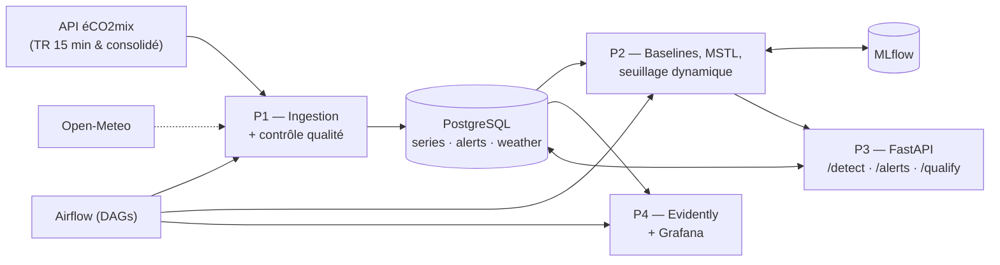

# Détection d'anomalies sur le réseau électrique français (MLOps)

Service MLOps de bout en bout qui surveille les données ouvertes **éCO2mix** de RTE (API Opendatasoft) pour détecter les anomalies de consommation, de production ou de mesure, en distinguant les vrais incidents des effets saisonniers et calendaires.

> Ce wiki **résume et oriente**. Le détail vit dans le dépôt ([README](https://github.com/Sathapana/jun25_alt2_mle_mlops_anomalies_elec/blob/main/README.md), [CONTRIBUTING](https://github.com/Sathapana/jun25_alt2_mle_mlops_anomalies_elec/blob/main/CONTRIBUTING.md), [docs/](https://github.com/Sathapana/jun25_alt2_mle_mlops_anomalies_elec/tree/main/docs)) et l'avancement dans [Jira SCRUM](https://sathapanachawananon.atlassian.net/jira/software/projects/SCRUM/boards).

## Par où commencer

| Je suis… | Lire d'abord |
| :--- | :--- |
| Nouveau dans l'équipe | [Démarrage rapide](Demarrage-rapide) → [Conventions d'équipe](Conventions-equipe) |
| **P1** — Data & Ingestion | [Données](Donnees) → [Constats et décisions](Constats-et-decisions) |
| **P2** — Modélisation & Détection | [Constats et décisions](Constats-et-decisions) (pas de temps !) → [Architecture](Architecture) |
| **P3** — MLOps, Orchestration & API | [Architecture](Architecture) → [Démarrage rapide](Demarrage-rapide) |
| **P4** — Observabilité & Dashboard | [Architecture](Architecture) → [Feuille de route](Feuille-de-route) (Phase 4) |

## Flux en un coup d'œil

## Pages

- [Démarrage rapide](Demarrage-rapide) — installer, tester, lancer la stack Docker.
- [Conventions d'équipe](Conventions-equipe) — tickets Jira, statuts, Git, PR, communication.
- [Architecture](Architecture) — stack, modules P1–P4, contrats de données.
- [Données](Donnees) — jeux éCO2mix et météo, couches de stockage.
- [Constats et décisions](Constats-et-decisions) — ce qu'on a appris, ce qu'on a décidé, ce qui reste ouvert.
- [Feuille de route](Feuille-de-route) — phases, étapes, jalons.
